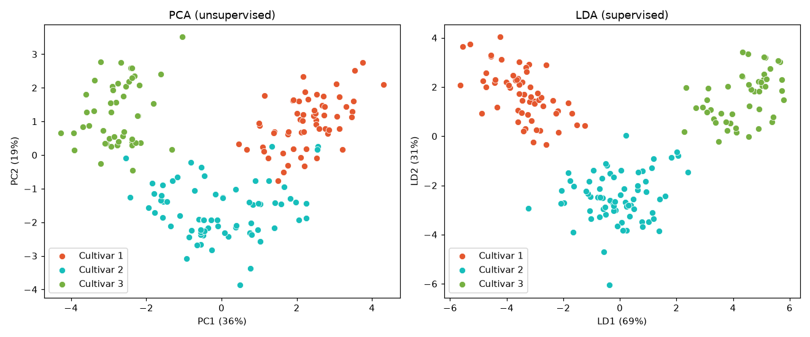

# 🍷 Wine Classification with LDA


This project uses **Linear Discriminant Analysis (LDA)**, a *supervised* dimensionality reduction method, to project 13 chemical measurements of wine onto the **2 axes that best separate the three cultivars**. A logistic regression then classifies each wine in that 2-D space.
An interactive Streamlit dashboard shows the decision regions and lets you place your own wine on the map.

## 📊 Results

Wine dataset: 178 wines, 13 features, 3 cultivars. Test results are on a stratified 20% hold-out set.

| Setup | 10-fold CV accuracy | Test accuracy |
|---|---|---|
| All 13 features | 98.6% ± 2.8 | 97.2% |
| PCA, 2 components | 97.2% ± 3.4 | 91.7% |
| **LDA, 2 components** | **99.3% ± 2.0** | **97.2%** |



**Takeaway:** with only 2 features, LDA **matches or beats the model that uses all 13**.
Unlike PCA, which keeps the directions of largest variance, LDA uses the labels to find the directions that pull the classes apart. On the right of the plot the three cultivars form clean, well-separated clusters. Compare this with the [PCA project](https://github.com/salemyousry4-design/PCA-For-Large-Dataset).

## ✨ Dashboard features

- **13 sliders** for the wine chemistry
- **Live prediction** with class probabilities
- **Interactive LDA map** with the decision regions and your wine shown as a ⭐
- Side-by-side accuracy: 2 discriminants vs all 13 features

## 🚀 Quick start

```bash
git clone https://github.com/salemyousry4-design/lda-wine-classification.git
cd lda-wine-classification
pip install -r requirements.txt

streamlit run app.py     # interactive dashboard
python analysis.py       # print the comparison table and regenerate the plot
```

## 📁 Project structure

```text
├── app.py              # Streamlit dashboard
├── analysis.py         # full features vs PCA vs LDA evaluation
├── data/wine.csv       # UCI Wine dataset (target column: Customer_Segment = cultivar)
├── reports/            # generated plots
└── notebooks/          # exploratory notebook
```

## 👤 Author

**Salem Yousry**: [GitHub](https://github.com/salemyousry4-design)
